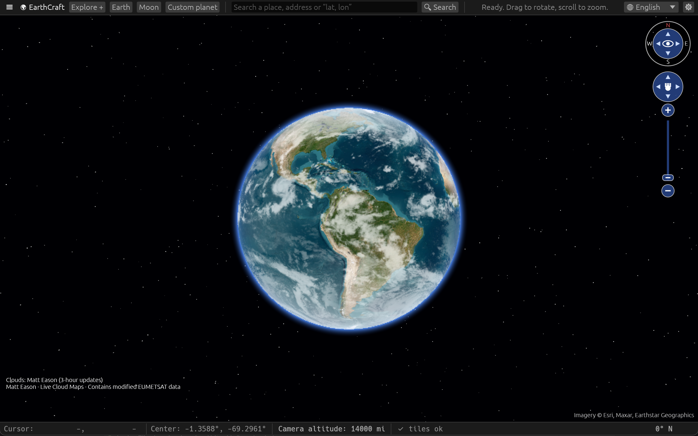

[**English**](README.md) | [Brazilian Portuguese](README.pt-BR.md)

# EarthCraft 🌍

A 3D globe explorer in the style of Google Earth, written in pure Rust (egui + CPU ray-casting globe rendering, with optional, experimental GPU acceleration). Runs on Windows, macOS and Linux.

### Build and run

Requires Rust 1.95+ (https://rustup.rs):

    cargo run --release

Linux (if something is missing):  `sudo apt install libxkbcommon-dev libwayland-dev libx11-dev` / `sudo apt install build-essential pkg-config libatk1.0-dev libgtk-3-dev`

An internet connection is required to download map tiles.

The release workflow provides Linux archives, AppImage, DEB, RPM, Flatpak and Snap;
Windows portable builds and MSI installers for x64 and ARM64; and a FreeBSD
x86-64 archive. macOS downloads remain Apple Silicon DMGs. See the
[release guide](docs/RELEASING.md) for runtime requirements and installation.

**macOS downloads (Apple Silicon):** Open the DMG and drag EarthCraft to Applications. The app
is not notarized, so Gatekeeper may block the first launch. Try opening it once,
dismiss the warning, then go to **System Settings → Privacy & Security → Open
Anyway** for EarthCraft and confirm **Open**. See [Apple's instructions](https://support.apple.com/en-us/102445).

### Features

- High-performance optimized 3D globe renderer
- Navigation controls for orbit, zoom and view rotation, with a compass, rotation ring, movement pad and zoom slider; includes a north-up reset and can be hidden in Settings
- Satellite imagery (credit: Esri), streets (credit: OSM) and topography (credit: OpenTopoMap), with multi-level tile zoom and configurable on-disk caching
- Atmosphere, stars, real-time sunlight (day/night)
- Bottom bar with cursor position, camera center position, editable camera altitude and bearing
- AIS ship positions (credit: OpenSeaFeed), with partial worldwide coverage and a Finland-only Fintraffic fallback
- Live traffic congestion (credit: TomTom; requires an API key)
- Live precipitation radar (credit: RainViewer) and satellite cloud imagery (credit: Matt Eason)
- Real aircraft positions (credit: OpenSky Network and ADSB.lol), with global and nearby tracking
- Satellite positions predicted from CelesTrak orbital data using an approximate two-body model
- Place and address search (credit: Nominatim), plus direct "lat, lon" coordinate input
- Animated fly-to (double-click, search or list)
- Placemarks in an editable KML folder tree, with visibility controls and drag-to-folder organization
- Extensible Earth geodesy model selector: WGS 84 (G2296) by default, with Perfect Sphere available as an alternative
- Geodesic distance ruler (great-circle or ellipsoidal), with exact decimal-degree point entry/editing, undo/redo, separate paths (Alt-click), selectable metric, imperial, nautical, angular and novelty units and initial bearing for the last segment
- Togglable Lat/lon grid with optional coordinate labels
- Distance scale bar that adjusts as you zoom, showing the real-world distance represented on the map
- Clean one-click PNG screenshot export of the globe without the app interface, saved to the folder selected in Settings
- Right-click context menu: view or copy a location's coordinates, add a placemark, fly to that location or add a ruler point
- Explorer add-on: place coordinates and OpenStreetMap details, Wikimedia Commons photo search, editable narrated tours using system text-to-speech, and controls for live weather, cloud and aircraft layers
- Moon view and custom PNG/JPEG planet and sky previews, with portable `.earthplanet` files that embed their images
- Optional self-updating as new GitHub Releases are pushed

### Controls

Drag: rotate globe · Right-click: location context menu · Right-drag / Shift+drag: rotate view · Wheel / +/-: zoom · Double-click: fly to point · Arrow keys: move · N: north up

Click **Camera altitude** in the bottom bar to enter an exact altitude.

Use **☰** in the toolbar to hide or reopen the sidebar and give the map more room.

On macOS, the native **File** menu opens/saves KML and saves PNG screenshots. Use Cmd+O to open, Cmd+S to save, Cmd+Shift+S for Save As, and Cmd+Shift+E for a screenshot. Screenshots use the folder selected in Settings. Quit is in the application menu. Windows and Linux use the sidebar's file controls and the same shortcuts with Ctrl instead of Cmd; Ctrl+Q quits.

Open **Explore +** in the top bar to access the Explorer add-on. Narration uses
system text-to-speech; Linux requires `espeak`. The panel follows the language
selector, and changing language preserves user-written narration.

### Limitations

Detailed 3D terrain, 3D buildings, Street View, Google Earth Studio and geotagged
photo layers are not implemented. Place details and Wikimedia Commons photo
searches open in your browser; photos are not embedded in the application.

Map tiles, aircraft, AIS ships, traffic and weather layers depend on third-party
services and coverage. Please respect their terms of use (OSM limits heavy usage). Explorer's
external websites require an internet connection. Moon and custom planet views
use egui meshes; the experimental GPU globe renderer applies to Earth.

### Development

The desktop app lives in `apps/earthcraft`, with reusable libraries in `crates/`.
See the [architecture](docs/ARCHITECTURE.md), [contributing guide](CONTRIBUTING.md),
and [agent rules](AGENTS.md) for module ownership, checks, and how to extend the project.
