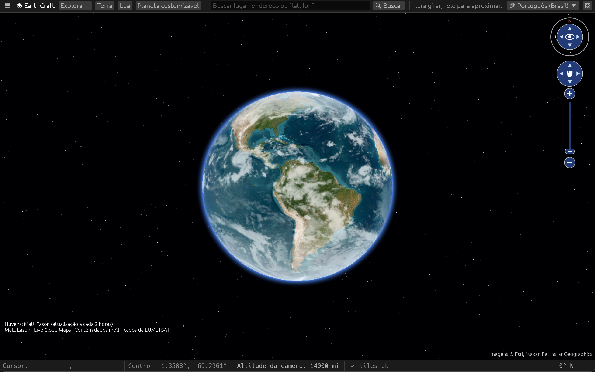

[English](README.md) | [**Português (Brasil)**](README.pt-BR.md)

# EarthCraft 🌍

Um explorador de globo 3D no estilo do Google Earth, escrito em Rust puro (egui + renderização do globo por ray-casting na CPU, com aceleração experimental e opcional na GPU). Funciona no Windows, macOS e Linux.

### Compilar e executar

Requer Rust 1.95+ (https://rustup.rs):

    cargo run --release

Linux (se faltar algo): `sudo apt install libxkbcommon-dev libwayland-dev libx11-dev` / `sudo apt install build-essential pkg-config libatk1.0-dev libgtk-3-dev`

Uma conexão com a internet é necessária para baixar os tiles do mapa.

O fluxo de lançamento fornece arquivos Linux, AppImage, DEB, RPM, Flatpak e Snap;
versões portáteis e instaladores MSI para Windows x64 e ARM64; e um arquivo
para FreeBSD x86-64. Os downloads para macOS continuam como DMGs para Apple Silicon.
Veja o [guia de lançamento](docs/RELEASING.md) para requisitos e instalação.

**Downloads para macOS (Apple Silicon):** Abra o DMG e arraste o EarthCraft para Aplicativos.
O app não é notarizado, então o Gatekeeper pode bloquear a primeira abertura.
Tente abrir uma vez, feche o aviso e acesse **Ajustes do Sistema → Privacidade e
Segurança → Abrir Mesmo Assim** para o EarthCraft. Confirme em **Abrir**.
Consulte as [instruções da Apple](https://support.apple.com/pt-br/102445).

### Funções

- Renderizador de globo 3D otimizado para alto desempenho
- Controles de navegação para órbita, zoom e rotação da vista, com bússola, anel de rotação, controle direcional e controle deslizante de zoom; incluem um botão para orientar o norte para cima e podem ser ocultados nas Configurações
- Imagens de satélite (crédito: Esri), ruas (crédito: OSM) e topografia (crédito: OpenTopoMap), com tiles em múltiplos níveis de zoom e cache em disco configurável
- Atmosfera, estrelas e luz solar em tempo real (dia/noite)
- Barra inferior com posição do cursor, posição do centro da câmera, altitude da câmera editável e rumo
- Posições de navios via AIS (crédito: OpenSeaFeed), com cobertura mundial parcial e fonte alternativa Fintraffic restrita à Finlândia
- Congestionamento em tempo real (crédito: TomTom; requer uma chave de API)
- Radar de precipitação em tempo real (crédito: RainViewer) e imagens de nuvens por satélite (crédito: Matt Eason)
- Posições de aeronaves reais (crédito: OpenSky Network e ADSB.lol), com rastreamento global e nas proximidades
- Posições de satélites previstas a partir de dados orbitais do CelesTrak usando um modelo aproximado de dois corpos
- Busca de lugares e endereços (crédito: Nominatim), além de entrada direta de coordenadas "lat, lon"
- Voo animado até o destino (duplo clique, busca ou lista)
- Marcadores de lugares em uma árvore editável de pastas KML, com controles de visibilidade e organização por arrastar para pastas
- Seletor extensível de modelos geodésicos da Terra: WGS 84 (G2296) por padrão, com Esfera perfeita como alternativa
- Régua de distância geodésica (grande círculo ou elipsoidal), com entrada e edição de pontos em graus decimais exatos, desfazer/refazer, trajetos separados (Alt+clique), unidades métricas, imperiais, náuticas, angulares e divertidas selecionáveis e rumo inicial do último segmento
- Grade de latitude/longitude que pode ser ativada ou desativada, com rótulos de coordenadas opcionais
- Barra de escala que se ajusta ao zoom e mostra a distância real representada no mapa
- Exportação de captura PNG do globo com um clique, sem a interface do aplicativo, salva na pasta selecionada nas Configurações
- Menu de contexto com o botão direito: veja ou copie as coordenadas de um local, adicione um marcador, voe até o local ou adicione um ponto à régua
- Módulo Explorar: coordenadas de lugares e detalhes no OpenStreetMap, busca de fotos no Wikimedia Commons, passeios narrados editáveis com síntese de voz do sistema e controles para camadas de meteorologia, nuvens e aeronaves em tempo real
- Visualização da Lua e prévias de imagens PNG/JPEG de planetas e céus personalizados, com arquivos portáteis `.earthplanet` que incorporam as imagens
- Atualização automática opcional conforme novas versões são publicadas no GitHub Releases

### Controles

Arrastar: girar o globo · Clique com o botão direito: menu de contexto do local · Arrastar com o botão direito / Shift+arrastar: girar a vista · Roda / +/-: zoom · Duplo clique: voar até o ponto · Setas: mover · N: norte para cima

Clique em **Altitude da câmera** na barra inferior para informar uma altitude exata.

Use **☰** na barra de ferramentas para ocultar ou reabrir o painel lateral e dar mais espaço ao mapa.

No macOS, o menu nativo **Arquivo** abre/salva KML e salva capturas PNG. Use Cmd+O para abrir, Cmd+S para salvar, Cmd+Shift+S para Salvar como e Cmd+Shift+E para uma captura. As capturas usam a pasta escolhida nas Configurações. Sair fica no menu do aplicativo. Windows e Linux usam os controles de arquivos do painel lateral e os mesmos atalhos com Ctrl em vez de Cmd; Ctrl+Q sai do aplicativo.

Abra **Explorar +** na barra superior para acessar o módulo Explorar. A narração
usa a síntese de voz do sistema; no Linux, requer `espeak`. O painel acompanha o
seletor de idioma, e a troca de idioma preserva a narração escrita pelo usuário.

### Limitações

Terreno 3D detalhado, prédios 3D, Street View, Google Earth Studio e camadas de
fotos geolocalizadas não estão implementados. Os detalhes de lugares e as buscas
de fotos no Wikimedia Commons abrem no navegador; as fotos não são incorporadas
ao aplicativo.

Os tiles do mapa e as camadas de aeronaves, navios AIS, trânsito e meteorologia
dependem dos serviços e da cobertura de terceiros. Respeite os termos de uso
(OSM limita o uso intenso). Os sites externos do módulo Explorar requerem conexão
com a internet. As visualizações da Lua e dos planetas personalizados usam malhas
do egui; o renderizador experimental do globo na GPU se aplica à Terra.

### Desenvolvimento

O aplicativo fica em `apps/earthcraft`, com bibliotecas reutilizáveis em `crates/`.
Veja a [arquitetura](docs/ARCHITECTURE.pt-BR.md), o [guia de contribuição](CONTRIBUTING.md)
e as [regras para agentes](AGENTS.md) para entender as responsabilidades dos módulos,
as verificações e como ampliar o projeto.
