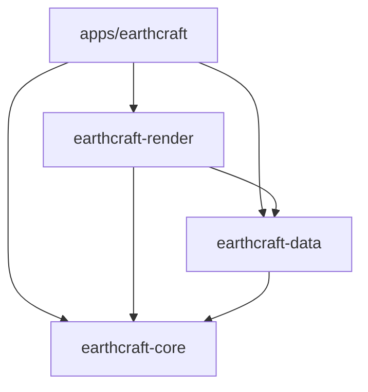

# Architecture

[English](ARCHITECTURE.md) | [Português (Brasil)](ARCHITECTURE.pt-BR.md)

EarthCraft 0.2.0 is a Cargo workspace with one desktop application and three libraries.

Libraries never depend on the application. The workspace manifest owns versions,
package metadata and build profiles; `Cargo.lock` pins resolved dependencies.
`apps/earthcraft` is the default member, so `cargo run --release` starts the app.

| Package | Responsibility | Entry points |
| --- | --- | --- |
| `earthcraft` | Native startup, input, UI state, font layout, styled shapes and texture upload | `main.rs`, `app/mod.rs`, `app/ui`, `app/rendering.rs`, `app/overlays` |
| `earthcraft-core` | Double-precision math, camera/picking/flight, Unicode name normalization, language, Fluent catalogs and placemarks | `camera`, `flight`, `math`, `language`, `localization`, `placemark` |
| `earthcraft-data` | Async HTTP, tiles, boundaries, local search, KML, settings and persistence | `runtime`, `http`, `tiles`, `boundaries`, `search`, `kml`, `files`, `settings` |
| `earthcraft-render` | CPU rasterization, frame scheduling, geographic overlay preparation and tile priorities | `worker`, `overlays` |

## Rendering and UI

The desktop uses eframe/egui/emath 0.36 with eframe's default wgpu UI backend
and upstream graphics backend fallbacks. The saved Uncap FPS preference selects
automatic non-vsync presentation at startup; other presentation defaults remain
unchanged. Background completion polling runs in `App::logic`, including
while hidden; panels and widgets run in `App::ui` using the root UI, which also
provides context access through dereferencing. The optional
compute renderer uses wgpu 30 independently of the UI backend, with shader tests
using its matching `wgpu::naga` re-export. The workspace requires Rust 1.95 and uses Edition 2024 with Cargo resolver 3.
Fixed-size geographic segments use array windows without changing arithmetic
order. Render benchmarks and device-loss fixtures inject private cache roots;
normal startup retains the existing platform cache path and limits. App-owned
frame timing gives repeated layout passes a zero movement delta, preventing held
navigation controls from advancing twice in a presented frame.

The app captures immutable camera/style/layer inputs. A render-owned coordinator
holds one active job, one replaceable pending request and one completed frame.
Provider, release, size and style changes reject incompatible results; compatible
completed camera snapshots remain presentable during motion. Picking, borders,
labels and scale use the displayed camera, keeping input and overlays aligned.

CPU rasterization uses the shared Rayon pool, eight-row tile batches and `wide`
four-lane f64 rays. Geographic conversion and LOD stay in f64; glam handles camera
matrices/quaternions and SIMD colors. Batch-local tile handles avoid repeated cache
reads and are released after the batch. Safe bytemuck casts describe byte pixels;
workspace code forbids unsafe Rust. Native macOS menus stay in the desktop
adapter; their callbacks queue actions and wake egui. Windows and Linux use
an in-window menu with the same command catalog, alongside sidebar controls.
The macOS menu registers Window/Help with the system, while About and shortcut
help use app-owned egui windows. Captions, enablement and checkmarks update from
the current language and app state. See [desktop menus](features/NATIVE_MENUS.md).
The sidebar can be collapsed from the persistent toolbar
button; its settings and sections remain available when reopened.
The toolbar ruler shortcut toggles the sidebar's existing ruler state and,
when enabling it, requests that its section expand and scroll into view,
retaining measurements and history. The camera shortcut uses the same screenshot job as the sidebar
and native menu. The file worker reserves screenshot names with `create_new`
and adds numeric suffixes on collisions before encoding the unchanged PNG pixels.
The pin shortcut shares the sidebar's At center placemark action, including
selected-folder insertion and localized default names. A pending reveal reopens
Placemarks and focuses/scrolls its existing name editor into view.
The top/bottom panel layout lives in `app/ui/bars.rs`; the search input and
submission widgets live in `app/ui/search_bar.rs`. Query state, suggestion
merging/debouncing and search dispatch stay in `app/search.rs`, while
`app/ui/suggestions.rs` draws the results popup.
The toolbar status readout lives in `app/ui/status.rs`, with text at 90% of the
Body font size. It fits text using that same font, retains filename endings and
shows the full message on hover only when text or a file path is shortened.

The coordinator prepares CPU image data and matching overlay geometry before
publication. Egui uploads textures and builds styled shapes on its own thread.
RGBA buffers are reused when uniquely owned; screenshots retain immutable `Arc`
snapshots, so an export never reads a recycled frame. PNG encoding runs on the
bounded file worker.

## Live layers and the hidden illustration

Cloud/radar imagery, roads, AIS vessels, predicted satellite subpoints and traffic rasters use a
render-owned preparer and coalesced worker: one active request, one replaceable
pending request and one completed result. Inputs hold immutable `Arc` snapshots.
Moving raster frames carry geometry prepared for their camera; stationary data
refreshes use the same preparer off the UI thread. The app rejects geometry with
an incompatible camera, rectangle, DPI, scale, data identity or orbital time tick.
Weather and traffic rasters project parallel rows with Rayon; render owns their bounded
moving/settled sizing policy. Only matching displayed-view results are uploaded.
Roads/vessels/traffic reuse their prepared components when only satellite time
changes. Screen projection uses the selected Earth's surface; road hover tests
all visible fragments after a cheap prepared-bounds rejection.

Egui owns final styled mesh/label caches and texture upload. Traffic image
projection and tile decode/stitching stay off egui; the data-owned feature and
tile workers also perform OSM geometry conversion, AIS conversion and OMM
conversion. Snapshots are allocated before publication, so applying a result
swaps shared ownership instead of cloning fleets or road arrays. Service URLs,
refresh intervals, retries, source fallback and draw order remain unchanged.
Traffic completions from a replaced or cleared API key are discarded.
Nearby OSM municipal requests never overlap; their loading status is separate
from the initial border/name datasets.

`earthcraft-core::orbit` owns the existing approximate two-body propagation;
data owns CelesTrak format/epoch decoding. This preserves the existing educational
model, not SGP4 precision, and rejects invalid/non-finite orbital elements.
Normal live-layer labels use Fluent; errors retain structured causes until status
formatting. Roads' zoom limit uses the selected distance units (180 km / 112 mi).

The flat-Earth illustration remains a separate hidden scene with its existing
shortcuts, pan/rotate/zoom/reset/exit controls. It never changes `EarthModel`.
Its embedded image loads on the file worker. The app shares a static disk
layout (3,201 vertices / 6,144 triangles), caches tessellated stars/rim/surface
meshes per viewport/rotation/zoom/texture/DPI, and rebuilds only when that view
changes. Image completion after exit cannot reopen it. See the isolated
construction comparison in `PERFORMANCE_BASELINE.md`.

## Overlays and spatial indexes

Render owns geographic visibility, border projection and ordered label candidates.
A packed `geo-index` R-tree indexes immutable boundary-line bounds, with conservative
3D horizon/frustum tests and dateline/pole handling. Dataset changes rebuild the
index; camera changes query it. Source order and visible line interiors are preserved.

The app caches one displayed set of egui shapes/galleys. Camera, viewport, DPI,
altitude, dataset, layers, language and text scale invalidate it. Tile arrivals and
unrelated UI updates reuse unchanged projections. Stationary changes use a coalesced
overlay worker; moving frames carry their matching geometry. Font measurement,
final label occupancy and styled shapes remain on egui. Mutable `rstar` indexes
accepted screen rectangles in priority order, including touching-edge rejection,
padding and the 500-label limit. Placemarks and ruler edits remain immediate. Optional graticule label candidates
are prepared by the same background worker using the displayed raster grid step.
Render aligns candidates on shared column/row guides inside the visible globe,
swapping axes with view orientation. The desktop measures monospaced labels,
anchors them consistently and rejects collisions with place names and other grid
labels. Core owns disconnected ruler paths, bounded undo/redo history (100 edits),
path-aware distance totals, true-north heading formatting and initial great-circle
bearings; the desktop draws the status heading and compass. Pointer drags use core
move transactions so one drag is one history step. Native Edit menu commands
and keyboard shortcuts route to ruler history unless a text edit has focus. The
ruler coordinate editor accepts separate latitude/longitude decimal-degree fields,
uses core’s shared `coordinates` module to validate finite values within
±90°/±180°. Search coordinate queries use the same parser after splitting
comma, semicolon or whitespace separators. Core also validates decoded numeric
coordinates for geocoding, suggestions, GeoJSON boundaries/labels and KML I/O.
Data owns JSON/XML decoding and longitude-first format adaptation. Invalid
service coordinates are skipped; invalid KML coordinates return a typed error
before an import completes or an export touches its destination. The editor adds/edits points through
the same history. Input and editing preserve the stored f64 values without display
rounding. Realistic — WGS 84 (G2296) is the default; the 6,371.0088 km sphere remains
an optional model. The persisted selection routes camera, picking, rendering, geographic overlays and
geodesics through core's Earth-model boundary; model changes invalidate compatible
frame/overlay caches. See [Earth models](features/EARTH_MODELS.md) for supported calculations,
reference-frame limits and extension points. Precise entry alone does not establish
survey-grade accuracy.

## Async services and files

The app owns one Tokio `ServiceRuntime` and injects handles/repaint callbacks.
Pooled reqwest clients enforce response limits, timeouts and retry policies.
Network I/O runs asynchronously; bounded feature, tile-decoding and file workers
separate CPU-heavy parsing from interactive imagery. A panic in one of those
jobs is returned as that job's error, so the pool and the application keep
running. Six async tile workers use
48-job admission, current-view priority and delayed retries; stale queued detail
is retired while active work and coarse overview jobs remain.

Boundary processors stream GeoJSON feature collections, share immutable coordinate
lines, merge/deduplicate patches, and publish immutable geometry/name snapshots.
Municipal geometry loads when its layers are enabled; labels can load independently.
Loaded-name prefix search uses background-built Unicode-normalized FST indexes,
with scanning during rebuilds. Ranking and remote-result merging remain explicit.

GeoRust `kml` owns XML reading/writing. A bounded quick-xml preparation pass skips
empty Points, balances incomplete containers and wraps bare-coordinate fragments.
Core's `placemark` module owns a tree of Documents, Folders and point markers,
session-stable node IDs, inherited visibility and cycle-safe moves. Import/export
retains container order, names, descriptions, empty folders and visibility;
repeated saves do not introduce additional Document wrappers. The existing
first-coordinate policy for line/polygon Placemarks remains; this is not a
lossless editor for unsupported KML geometry, styles or network links.
The desktop draws disclosure arrows, full-width selectable rows and visibility
checkboxes, with a details editor for the selection. Compact rows use eight-point
indentation and vector folder/pin icons, independent of font glyph coverage.
The tree uses the height supplied by the sidebar layout; descriptions use a separate
three-line scrolling editor so long imported text cannot expand the sidebar.
Double-click flies to a
marker; drag onto a folder or My Places to move it. Creating a place/folder uses
the selected folder, otherwise the root. Hidden ancestors suppress map markers
without changing children's own visibility. File jobs capture the whole tree
at submission; decoding, encoding and filesystem work stay off the UI thread.
KML/KMZ I/O and screenshot encoding use an ordered bounded file service.
KMZ imports select the first KML entry in archive order without extracting
resources to disk. The entry is inflated with a 128 MiB limit on the bytes
actually decompressed (entry headers are untrusted), then takes the same XML
preparation pass and GeoRust `KmlReader` path as a plain KML file, so folder
visibility and malformed-document handling match. Archive and reader errors are
reported directly. Export writes the supported places tree as compressed
`doc.kml`. Embedded resources, styles and network links retain the existing
importer limitations.
Native dialogs
and result application belong to the app. Settings/language writes coalesce on a
filesystem worker and flush at shutdown; startup reads the small preference files.
Open KML source paths are stored separately in `open-kml.json` by that worker.
Startup reopens them in order on the file service, silently drops missing files
and rewrites the retained list; other failures remain visible and retry next launch.
Only paths are remembered, so unsaved tree edits require an explicit KML save.
A whole-tree save replaces the remembered sources with its destination to avoid
loading both the combined snapshot and its former inputs. Clear All empties the
tree and remembered list and discards pending KML results, without deleting sources.

Explorer image decoding (including the embedded Moon image) and planet document
I/O use that same file service. Texture upload remains on egui's thread. Planet
loads retain shared original encoded images, and saves snapshot their references,
selected paths and name at submission. Re-saving an imported planet does not
require its former image paths or re-encode its JPEG/PNG assets. Pending Explorer
file controls are disabled, and selecting another body prevents a late load from
changing the active body. The version-1 sidecar and version-2 embedded document
formats remain supported.

Live aircraft use a data-owned asynchronous controller with one coalesced camera
query and one latest immutable snapshot. It keeps at most one OpenSky and one
ADSB.lol request active. JSON decoding and source merging/sorting use the bounded
feature pool; the UI swaps shared snapshots, including shared immutable identifier
strings. Coordinates use core validation and movement refresh uses core's mean-radius
distance calculation. Provider URLs, response budgets, 17-minute/90-second refresh,
three-minute failure retry and 30-second movement throttle remain unchanged.
New requests pause when the layer or Earth body is hidden. Completed requests
still publish and wake the UI. Cached global samples expire after 20 minutes;
local samples retain the existing three-minute provider and 120-second position
limits, with expiry publication coalesced to the one-second marker cadence.
Re-enabling the layer with expired cached sources waits for background revalidation
before displaying those positions again.

Render prepares aircraft projection and ordered label candidates in a bounded
worker for stationary views, and alongside raster frames during motion. Both use
the same preparer and the displayed camera. Geometry is reused for unchanged
view/data/scale/DPI within a one-second time bucket; mismatched results never draw.
One previous tick may remain visible while refreshing, up to two seconds old;
expired geometry and older completions cannot replace a current result. Moving
frames timestamp aircraft preparation at completion rather than raster submission.
The 25-second extrapolation cap, icon geometry and label priority/spacing/count
limits remain unchanged. Core owns the spherical destination calculation. The app
owns Fluent statuses, English diagnostics, hover and font layout. It caches icon
meshes and text galleys for the current geometry, preserving paint order; glyph UVs
are not baked into cached meshes. No aircraft decoding, deduplication, sorting or
geographic projection runs in a widget callback.

## Application updates

Data's `updater` service uses the async GitHub backend from `self_update` 1.3
on the injected service runtime. It retains the selected stable version, exact
tag and asset identity, requires GitHub's SHA-256 digest, coalesces progress through
one watch snapshot and wakes the UI after publication. Downloads/installations are
click-triggered and single-flight. Library verification/extraction/replacement
runs off the UI thread; macOS replaces and verifies the whole app bundle.
Debug builds and executables in Cargo output skip update checks independently
of their version. Managed installations use the official release-page fallback.

The desktop owns the centered bottom-bar notice and restart/save orchestration.
It reuses native save dialogs and the bounded file service, waits for file
completions without blocking egui, and closes normally. Startup relaunches only
after `run_native` returns, so preference flushing and app teardown precede restart.
A failed restart reopens the desktop with an inline error and the saved documents.
See [releases](RELEASING.md) for artifact names, install policy and integrity limits.

## Cache ownership

| Storage | Policy |
| --- | --- |
| Decoded tiles | Moka `sync`, weighted LRU, 256 MiB best-effort target; temporary overshoot and frame references are separate |
| Encoded imagery | MBTiles 1.3 through one tokio-rusqlite worker; 128 MiB managed-file target, including SQLite overhead |

MBTiles separates providers, stable Wayback releases and encoded formats, converts
XYZ rows to TMS, and lazily imports legacy tile files. Eviction favors coarse
imagery and reclaims pages. Tiles publish before optional persistence. Clearing
removes only owned imagery files, rejects old-epoch writeback, preserves decoded
memory/settings/boundaries, and refreshes actual usage. SQLite R-tree/FTS5 support
is available for auxiliary catalogs; it is not duplicated in the tile hot path.

Satellite overview warming covers zooms 0–4 globally: 341 tiles, 85.25 MiB decoded.
It runs while idle at 14,000 km or farther away, after visible work, with bounded
admission. Other providers stay on demand. Cache roots resolve `LOCALAPPDATA`,
`XDG_CACHE_HOME`, `HOME/.cache`, then the temporary directory, under
`earthcraft_tiles`. Preferences remain `settings.json` and `lang.txt`.

## Units, localization and diagnostics

Settings exposes a System/explicit language preference separate from the resolved
session `Lang`. Core resolves supported system locales with English fallback;
the desktop uses its existing OS locale detector. Data persists `system`, `en`
or `pt-BR` in `lang.txt`, preserving old explicit choices. Missing preferences use
System Locale; selecting it never writes the resolved locale as an override.

Coordinates use degrees, internal altitude/distances use kilometers, and raster footprints
use meters. Core owns display conversions; the desktop detects the system locale
once and data persists the System/Metric/Imperial preference. EarthCraft defaults to miles/feet for the US, UK, Liberia, Myanmar, Belize,
Bahamas, US Virgin Islands, Guam, Puerto Rico, Cayman Islands, Guernsey, Jersey
and Isle of Man. This application policy extends CLDR's US/GB length defaults
to include mixed/traditional mile usage; it does not claim uniform statutory
units in those regions. Other locales and unknown regions use kilometers/meters. Clicking the camera altitude opens an exact-value editor in its displayed unit.
Core validates/converts entries within the existing camera limits; the desktop
owns the editor and applies accepted values, cancelling active flight.
Camera altitude and scale bar share the selection; the ruler's Automatic option
also follows it. Its separate saved selector supports centimeters, meters,
kilometers, inches, feet, yards, miles, nautical miles, smoots, degrees and
arcseconds. Angular units represent accumulated central angle on the mean-radius
sphere. Football fields (100 yards, excluding end zones) are available everywhere.
The selector uses “Football fields” for US system locales and “American football
fields” elsewhere, with localized names. Optional selector-name overrides are
separate from short measurement labels; totals and segments retain “football fields”. KML/GeoJSON arrays are longitude-first; domain pairs are latitude-first.
UI strings live in embedded `locales/{en,pt-BR}.ftl`, with matching semantic keys
and named whole-message arguments. Errors/logs are English; normal UI messages
follow the selected language. See [localization](LOCALIZATION.md).

Opt-in profiling records pipeline and queue timings through a bounded background
recorder. Normal builds compile it out. Component results and native measurements
are documented separately; neither raster timing nor app-side texture submission
is an application FPS guarantee. See [contributing](../CONTRIBUTING.md),
[CPU baseline](PERFORMANCE_BASELINE.md).

## Experimental GPU Earth rasterization / renderização experimental em GPU

The Earth overview raster can be computed by the `earthcraft-render` `backend`
module with `wgpu` compute shaders (`gpu/`), then read back for the existing
egui view. All GPU globe rendering is experimental on every platform; the CPU
path remains the default and fallback. Set
`EARTHCRAFT_RENDERER=auto` or `EARTHCRAFT_RENDERER=gpu` to enable an experimental GPU attempt.
The Explorer, live meteorological/aircraft layers, moon and custom planet
remain integrated in `apps/earthcraft`. See [GPU_RENDERER.md](features/GPU_RENDERER.md)
for hardware limits, performance and CPU-only build instructions.

## Frontend boundaries for EarthCraft web

Core owns body selection, spherical destination calculations and camera orbit/zoom
mapping. Render owns body meshes (positions/UVs/indices), weather compositing,
aircraft/ruler projection, scale-bar selection, raster sizing and frame keys.
These APIs use domain values, image buffers and `emath`, with no egui widgets,
texture handles or window objects. The desktop adapter uploads textures, measures
fonts, handles input and draws the returned geometry.

Data owns cloud/radar fetching, refresh/retry state, palette decoding, geographic
resource URLs and `.earthplanet` documents. Byte-oriented planet encode/decode APIs
support a frontend-provided legacy sidecar resolver; native path I/O is separate.
OS URL opening, speech commands and file dialogs remain desktop responsibilities.
This extraction prepares reusable logic; it does not make Tokio, SQLite, native
file services or GPU readback compile for WebAssembly. A web frontend still needs
browser transport/storage/execution adapters. Weather projection uses the bounded
render coordinator and coalesced live-layer worker; body meshes retain frontend scheduling.

## Sidebar panels

The desktop shell in `app/ui/sidebar.rs` composes a compact horizontal vector selector and
Explore/Layers/Places modules. Places can occupy the full panel or remain pinned
below another panel. Its tree height follows the available area; name/description
editing and core tree mutations remain in `app/ui/places.rs` and core respectively.
Data owns tolerant `SidebarLayout` persistence in the existing settings file;
the desktop owns drawing, splitter interaction and shortcut routing. No geometry,
KML fidelity or live-service behavior changes. See [sidebar](features/SIDEBAR.md)
and the [v0.2.0 plan](ROADMAP.md).

## Coordinate presentation

Core owns `CoordinateDisplay`, `CoordinateFormat` and recognized coordinate
queries. The `mgrs-convert` adapter handles UTM/UPS/MGRS; presentation changes
never rewrite geographic values. Data persists tolerant format/precision fields
and the desktop owns labels/copy controls. Recognized invalid input fails locally
in English; ordinary addresses retain remote search. See
[coordinate display](features/COORDINATE_DISPLAY.md).

## Preferences and fonts

Data owns tolerant appearance/navigation/cache preferences and applies configured
imagery budgets at cache construction. The app owns searchable category widgets,
OS font discovery and a bounded font-loading worker. Installed UI/map faces have
independent bundled fallbacks; font application invalidates cached overlay text.
Camera math remains in core. See [settings](features/SETTINGS.md).

## Controllers

Core owns normalized Explore bindings, response/deadzone policy, button edges and
camera steps, including bounded tilt from nadir with cached double-precision view transforms.
Data persists bounded per-model profiles and tolerantly loads pre-tilt startup cameras. The app's gilrs adapter
polls hotplug/input, arbitrates focus and dispatches tool actions through menus;
its settings module owns remapping and the live monitor. On macOS, a bounded,
nonexclusive HID reader decodes Nintendo Pro full reports and injects normalized
events into gilrs. Native device I/O and protocol decoding stay in the app;
the worker coalesces axes and retains bounded button edges, with read-only stick
calibration and neutral rearming after input loss. See
[controllers](features/CONTROLLERS.md) for device/platform limits.

## Celestial background

Core's celestial frame adapter uses sofars to transform Earth-fixed rays into
ICRF/J2000 directions. Data owns the pinned bundled image and bounded asynchronous
decode. Render owns equatorial bilinear sampling, daylight visibility and shared
CPU/GPU sky repair. App owns toggles, diagnostic/credit widgets and frame-matched
screenshot attribution. See [celestial background](features/CELESTIAL_BACKGROUND.md)
and the independent dataset manifest in assets/sky.
